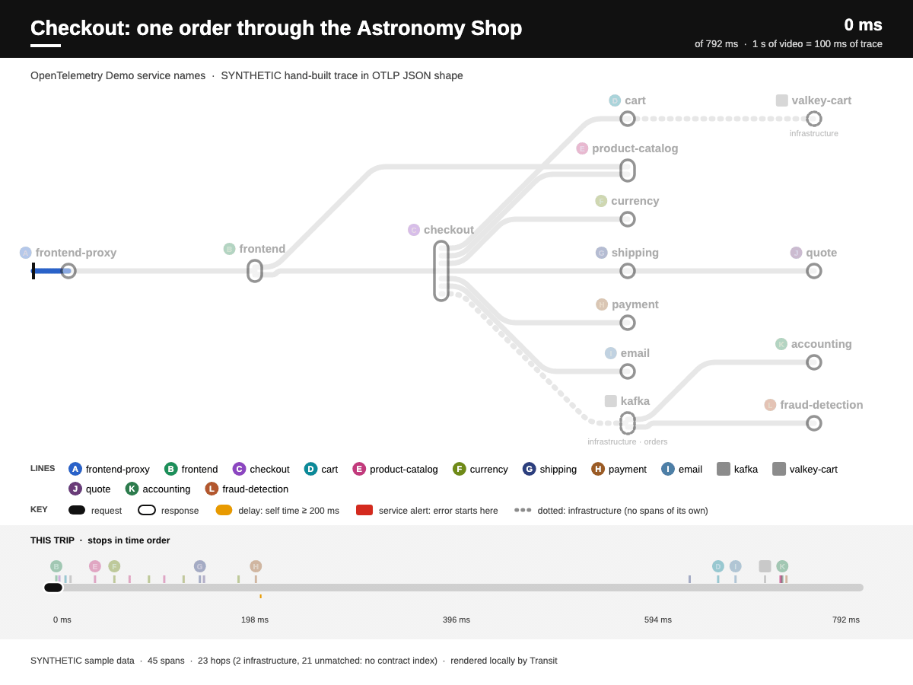
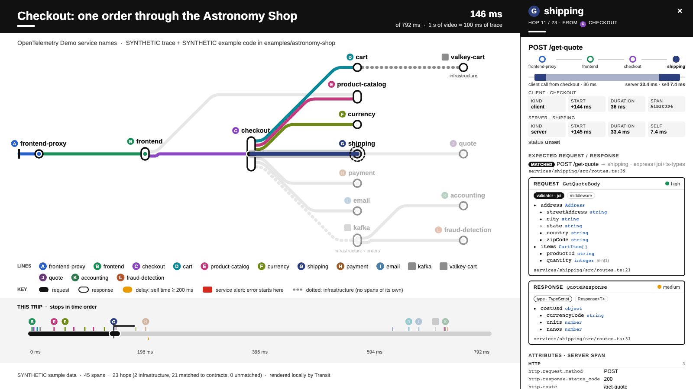
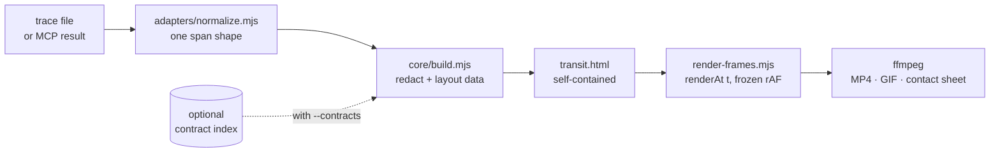

<p align="center">
  
</p>

<h1 align="center">🚇 request-transit</h1>

<p align="center"><b>A public transit map for your requests.</b></p>

<p align="center">
Turn one distributed trace into an animated subway map: services are lines, calls are trains, slow hops get a DELAY marker, and failures raise a SERVICE ALERT.<br>
Use it as an agent skill next to your observability MCP servers, open the interactive page, or render a frame-exact MP4/GIF for a PR, an incident doc or chat.
</p>

<p align="center">🔒 <b>Runs entirely on your machine. Your traces never leave it.</b><br>No telemetry, no tracking, no analytics, and there never will be.</p>

<p align="center"><sub>The GIF above was rendered by Transit from <code>samples/otel-demo-checkout.otlp.json</code> (a synthetic trace).</sub></p>

> [!NOTE]
> Early release (0.1). Not on npm. All sample data in this repo is synthetic.

## Quickstart

```sh
npm install
npm run build     # out/otel/transit.html: open it, press ? for shortcuts
npm run render    # out/otel/anim.mp4 + anim.gif + contact.png
```

Your own trace: `node core/render.mjs path/to/trace.json --name mine --title "Checkout, Tuesday 14:02"`.

The first run sets itself up and **reuses what you already have** before downloading anything:

- **Browser:** the first one that launches, in this order:
  - Playwright's own build, if another project already downloaded it.
  - Any other Chromium in the Playwright cache.
  - Your installed Google Chrome or Microsoft Edge.
  - Only if none of those works, a ~100 MB `chromium-headless-shell` download, announced before it starts.
- **ffmpeg:** ffmpeg on your PATH or in the Homebrew locations. If it's missing: `brew install ffmpeg` on macOS (announced first), or opt-in `TRANSIT_FFMPEG_STATIC=1`.
- **npm deps:** a single dependency, `playwright-core` (~13 MB).

`node core/setup.mjs --check` reports what would be used or downloaded and changes nothing. Flags and settings:

- `--no-download` / `TRANSIT_NO_DOWNLOAD=1` never downloads.
- `TRANSIT_BROWSER=/path|chrome|msedge` forces a browser.
- `TRANSIT_SKIP_SETUP=1` skips the check.

`.transit-cache/setup.json` records what was reused and what was installed. Two renders on the same machine and browser are byte-identical; different browsers or builds can differ by a few anti-aliased pixels.

## Use it from your agent

Transit is an [Agent Skill](https://agentskills.io): a folder with a `SKILL.md`. Install it, then ask something like *"draw trace 4bf92f… as a transit map"*.

**Any agent, one command** (via the open [`skills`](https://github.com/vercel-labs/skills) installer):

```sh
npx skills add israelvicars/request-transit -g -a claude-code -a codex -a cursor
```

This puts the skill in `~/.agents/skills/request-transit` (read by Codex and Cursor) and symlinks it into `~/.claude/skills/` for Claude Code.

**Claude Code plugin** (this repo is also a plugin marketplace):

```sh
claude plugin marketplace add israelvicars/request-transit
claude plugin install request-transit@request-transit
```

The skill then appears as `/request-transit:request-transit`. Plugin installs are versioned copies, so first-run setup reinstalls npm deps after each plugin update. Browser and ffmpeg are reused.

**Codex built-in installer:** inside Codex, run `$skill-installer install https://github.com/israelvicars/request-transit`.

**From a clone (symlink):**

| Client | User-level install (from this checkout) | Project-level |
| --- | --- | --- |
| **Claude Code** | `ln -s "$PWD" ~/.claude/skills/request-transit` | `.claude/skills/request-transit` |
| **Codex** | `ln -s "$PWD" ~/.agents/skills/request-transit` | `.agents/skills/request-transit` |
| **Cursor** | `ln -s "$PWD" ~/.cursor/skills/request-transit` (Cursor also reads `~/.agents/skills` and `~/.claude/skills`) | `.cursor/skills/request-transit` |

The folder name must be `request-transit` (Cursor requires it to match the skill `name`). All three follow symlinks.
Locations are from the official docs: [Claude Code](https://code.claude.com/docs/en/skills), [Codex](https://developers.openai.com/codex/skills), [Cursor](https://cursor.com/docs/skills).

> [!IMPORTANT]
> Rendering video launches headless Chromium. Codex's default `workspace-write` sandbox on macOS blocks that, so the skill stops and says so. Run that step with more access (for example `codex exec -s danger-full-access`) or render outside the sandbox. Claude Code works with its normal permission prompts. Details: [`references/agent-testing.md`](references/agent-testing.md).

### Next to MCP, not instead of it

Observability MCP servers (PostHog, Datadog, Grafana/Tempo, Sentry, AWS, …) are good at *finding* a trace. Transit is the step after that: the agent saves what the MCP tool returned, and Transit turns it into a picture a human can follow in ten seconds.

- It is a skill plus local scripts, not a server, so it adds no tool schemas to the context.
- It never needs API keys of its own; the headless fetch scripts read keys from env only.

## Supported sources

| Source | Input | Fetch | Status |
| --- | --- | --- | --- |
| OpenTelemetry (OTLP JSON) | file | any exporter / collector file | ✅ working, tested |
| Datadog | tracer/agent span JSON, Spans API v2 | MCP or `fetch.mjs datadog-api` | ✅ adapter tested · fetch **untested live** |
| PostHog Distributed Tracing | trace endpoint / MCP `apm-trace-get` | MCP or `fetch.mjs posthog-api` | ✅ adapter tested · fetch **untested live** |
| AWS X-Ray | BatchGetTraces / segment documents | `fetch.mjs xray` (AWS CLI) or AWS MCP `get_xray_trace` | ✅ adapter tested · fetch **untested live** |
| Grafana Tempo | `/api/traces` v1, `/api/v2/traces` JSON | `fetch.mjs tempo` (`TEMPO_URL`) or Grafana / Tempo MCP | ✅ adapter tested · fetch tested on a mock only, **untested live** |
| Jaeger | OTLP-shaped API responses | — | 🧭 planned ([research](references/more-sources.md)) |
| Sentry, Honeycomb, GCP Cloud Trace, Zipkin | — | — | 🧭 researched, not started |

"Adapter tested" means the format is parsed in unit tests and rendered from a synthetic sample. No live account has been used.

## What you get

- **The map.** Services are laid out left to right by call depth, with octilinear lines and 1970s-transit typography (Arimo, OFL). Dotted grey lines are infrastructure (databases, caches, brokers). A "this trip" strip shows the stops in time order.
- **Honest timing.** Every train leaves on the exact frame its span starts. DELAY means self time over a threshold, and SERVICE ALERT marks where the error *started*, not every ancestor.
- **Interactive page.**
  - **Keys:** `N`/`P` step through hops, `1`/`2`/`3` set the speed, `?` lists every shortcut.
  - **Click:** a station, train or line selects that hop.
  - **Side panel:** a station-sign header, a breadcrumb, a mini waterfall with self time, client and server timings, and grouped attributes.
  - **Deep links:** `#span=<id>`.
- **Deterministic video.** Two renders are byte-identical (`npm run verify` checks it, along with train timing and ffmpeg freeze/black detection).
- **Optional contract layer.** It shows each hop's *expected* request and response from your code: Express + Zod/Joi, NestJS + class-validator, TypeScript types, protobuf and OpenAPI. Shared-package imports are followed, and each shape gets a file:line and a confidence level. Gaps are shown, never guessed. It is opt-in: `node skills/request-transit/scripts/transit.mjs index`, then build with `--contracts`. See [`skills/request-transit/examples/astronomy-shop`](skills/request-transit/examples/astronomy-shop) for the demo.

<p align="center"></p>

## How it works



Each frame is a pure function `renderAt(t)`: no clock, no timers, no randomness. The interactive selection is drawn on top of that frame and is switched off in render mode, which is why the videos are reproducible.

## Privacy

🔒 **Runs entirely on your machine. Your traces never leave it. No telemetry, no tracking, no analytics, and there never will be.**

- **Local processing.** Parsing, layout, rendering and video export run locally (Node, a headless browser on your machine, ffmpeg). Nothing is uploaded.
- **A self-contained page.** `transit.html` inlines its data, script, fonts and icon. It loads nothing from a CDN, fetches no fonts and sends no beacons. `npm run test:network` opens the built page (with and without contracts), plays it, drives the panel and **fails on any network request**.
- **The only network use:**
  - First-run setup downloads, only when missing and announced first: npm deps, the headless browser, ffmpeg.
  - The optional fetch scripts (`skills/request-transit/scripts/fetch.mjs …`), which you run against **your own** Datadog, PostHog, AWS or Tempo account with keys from your environment. They never write keys anywhere.
- **Redaction before render.** Attribute keys that look like PII (user, email, token, auth, cookie, session, card, client IP…) are dropped at build time. Add more with `--redact k1,k2`. Request and response payloads are never shown (tracers don't record them). See [`references/adapters.md`](references/adapters.md#privacy).
- **Your code stays put.** The contract layer runs only when you ask, and the skill asks first. It reads your repos locally and caches results in `.transit-cache/`, which is gitignored and never committed.

## Project layout

| Path | |
| --- | --- |
| `SKILL.md`, `references/` | agent skill entry point; design system, adapters, sources, contracts, config |
| `core/` | build (trace → self-contained HTML), subway template, frame renderer, ffmpeg export, fonts |
| `adapters/` | OTLP, Tempo, PostHog, Datadog, Datadog v2 and X-Ray → normalized spans; API/CLI fetch scripts |
| `contracts/` | optional contract layer: extractors, index, matcher |
| `core/` + `skills/request-transit/scripts/` | shared setup/render/verify/still and request-transit fetch/index/tests |
| `samples/`, `examples/` | synthetic traces and a synthetic example app |
| `docs/` | README images |

```sh
npm test                 # adapters + contract layer
npm run test:ui          # Playwright keyboard, click and scroll tests
npm run verify           # also verify:dd, verify:posthog, verify:xray, verify:tempo
```

## License

MIT

Not affiliated with or endorsed by the MTA.
