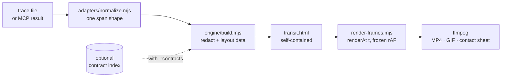

<p align="center">
  
</p>

<h1 align="center">🚇 request-transit</h1>

<p align="center"><b>A public transit map for your requests.</b></p>

<p align="center">
Turn one distributed trace into an animated subway map: services are lines, calls are trains, slow hops get a DELAY marker, and failures raise a SERVICE ALERT.<br>
Use it as an agent skill next to your observability MCP servers, open the interactive page, or render a frame-exact MP4/GIF for a PR, an incident doc or chat.
</p>

<p align="center"><sub>The GIF above was rendered by Transit from <code>samples/otel-demo-checkout.otlp.json</code> (a synthetic trace).</sub></p>

> [!NOTE]
> Pre-release. Nothing is published yet (no npm package, no public repo). All sample data in this repo is synthetic.

## Quickstart

```sh
npm install
npm run build     # out/otel/transit.html: open it, press ? for shortcuts
npm run render    # out/otel/anim.mp4 + anim.gif + contact.png
```

Your own trace: `node scripts/render.mjs path/to/trace.json --name mine --title "Checkout, Tuesday 14:02"`.

The first run sets itself up. It checks for Node 18+, installs npm deps and Playwright Chromium if they are missing, and installs ffmpeg with Homebrew on macOS (on Linux it prints the `apt`/`dnf` command). The result is cached in `.transit-cache/setup.json`; `node scripts/setup.mjs --force` re-checks.

## Use it from your agent

Transit is an [Agent Skill](https://agentskills.io): a folder with a `SKILL.md`. Link this checkout into your client's skills folder, then ask something like *"draw trace 4bf92f… as a transit map"*.

| Client | Install (from this checkout) |
| --- | --- |
| **Claude Code** | `ln -s "$PWD" ~/.claude/skills/transit` (or `.claude/skills/transit` inside one repo) |
| **Cursor** | `ln -s "$PWD" ~/.cursor/skills/transit` (Cursor also reads `~/.claude/skills`) |
| **Codex** | `ln -s "$PWD" ~/.agents/skills/transit` (or `.agents/skills/transit` inside one repo) |

Folder locations come from each client's docs: [Claude Code](https://code.claude.com/docs/en/skills), [Cursor](https://cursor.com/docs/skills), [Codex](https://developers.openai.com/codex/skills).

### Next to MCP, not instead of it

Observability MCP servers (PostHog, Datadog, Sentry, Grafana, AWS, …) are good at *finding* a trace. Transit is the step after that: the agent saves what the MCP tool returned, and Transit turns it into a picture a human can follow in ten seconds.

- It is a skill plus local scripts, not a server, so it adds no tool schemas to the context.
- It never needs API keys of its own; the headless fetch scripts read keys from env only.

## Supported sources

| Source | Input | Fetch | Status |
| --- | --- | --- | --- |
| OpenTelemetry (OTLP JSON) | file | any exporter / collector file | ✅ working, tested |
| Datadog | tracer/agent span JSON, Spans API v2 | MCP or `fetch.mjs datadog-api` | ✅ adapter tested · fetch **untested live** |
| PostHog Distributed Tracing | trace endpoint / MCP `apm-trace-get` | MCP or `fetch.mjs posthog-api` | ✅ adapter tested · fetch **untested live** |
| AWS X-Ray | BatchGetTraces / segment documents | `fetch.mjs xray` (AWS CLI) or AWS MCP `get_xray_trace` | ✅ adapter tested · fetch **untested live** |
| Jaeger, Grafana Tempo | OTLP-shaped API responses | — | 🧭 planned ([research](references/more-sources.md)) |
| Sentry, Honeycomb, GCP Cloud Trace, Zipkin | — | — | 🧭 researched, not started |

"Adapter tested" means the format is parsed in unit tests and rendered from a synthetic sample. No live account has been used.

## What you get

- **The map.** Services are laid out left to right by call depth, with octilinear lines and 1970s-transit typography (Arimo, OFL). Dotted grey lines are infrastructure (databases, caches, brokers). A "this trip" strip shows the stops in time order.
- **Honest timing.** Every train leaves on the exact frame its span starts. DELAY means self time over a threshold, and SERVICE ALERT marks where the error *started*, not every ancestor.
- **Interactive page.**
  - **Keys:** `N`/`P` step through hops, `1`/`2`/`3` set the speed, `?` lists every shortcut.
  - **Click:** a station, train or line selects that hop.
  - **Side panel:** a station-sign header, a breadcrumb, a mini waterfall with self time, client and server timings, and grouped attributes.
  - **Deep links:** `#span=<id>`.
- **Deterministic video.** Two renders are byte-identical (`npm run verify` checks it, along with train timing and ffmpeg freeze/black detection).
- **Optional contract layer.** It shows each hop's *expected* request and response from your code: Express + Zod/Joi, NestJS + class-validator, TypeScript types, protobuf and OpenAPI. Shared-package imports are followed, and each shape gets a file:line and a confidence level. Gaps are shown, never guessed. It is opt-in: `node scripts/transit.mjs index`, then build with `--contracts`. See [`examples/astronomy-shop`](examples/astronomy-shop) for the demo.

<p align="center"></p>

## How it works



Each frame is a pure function `renderAt(t)`: no clock, no timers, no randomness. The interactive selection is drawn on top of that frame and is switched off in render mode, which is why the videos are reproducible.

## Privacy

- **Local only.** Traces are processed on your machine. `transit.html` inlines its data, fonts and icon, and makes no network calls when you open it.
- **Redaction before render.** Attribute keys that look like PII (user, email, token, auth, cookie, session, card, client IP…) are dropped at build time. Add more with `--redact k1,k2`. See [`references/adapters.md`](references/adapters.md#privacy).
- **Keys from env only.** The fetch scripts read `DD_*`, `POSTHOG_*` or your AWS CLI profile from the environment and never write them anywhere.
- **Code stays put.** The contract layer runs only when asked. The skill asks the user first, and its cache lives in `.transit-cache/` (gitignored).

## Project layout

| Path | |
| --- | --- |
| `SKILL.md`, `references/` | agent skill entry point; design system, adapters, sources, contracts, config |
| `engine/` | build (trace → self-contained HTML), subway template, frame renderer, ffmpeg export, fonts |
| `adapters/` | OTLP, PostHog, Datadog, Datadog v2 and X-Ray → normalized spans; API/CLI fetch scripts |
| `contracts/` | optional contract layer: extractors, index, matcher |
| `scripts/` | `setup`, `fetch`, `render`, `verify`, `still`, `transit` (index), tests |
| `samples/`, `examples/` | synthetic traces and a synthetic example app |
| `docs/` | README images |

```sh
npm test                 # adapters + contract layer
npm run test:ui          # Playwright keyboard, click and scroll tests
npm run verify           # also verify:dd, verify:posthog, verify:xray
```

## License

MIT
